# The Day Trader skill, India edition

<p align="center">
  
</p>

<p align="center">
  
  
  
  
  
  
  
</p>

11 Claude skills for day trading Indian stocks on the NSE: scan the Nifty for breakouts, read exchange filings, time every entry and exit, and replay every outcome before you risk a rupee.

A port of [Jakeschincariol/day-trader-skill](https://github.com/Jakeschincariol/day-trader-skill) (MIT) to India's NSE cash market: the IST clock and NSE holidays, every price on an NSE tick, Indian intraday charges in every number, Kite-shaped order tickets, and a built-in paper broker, so you need no broker account. Free, no signup, no API key: plain Python on public data (Yahoo `.NS` charts, NSE's archives and announcements, Google News).

> **Nothing here places an order on its own.** Paper trading is the default, and no trade goes anywhere until you type **yes** for that exact order. How firmly that is enforced depends on the broker mode: see [Fine print](#fine-print).

## Install

In Claude Code, from a clone of this repo:

```
/plugin marketplace add /path/to/day-trader-india
/plugin install day-trader-india@day-trader-india
```

Skills are then namespaced (`/day-trader-india:nse-scanner`), and the plugin's three hooks come with it: the kite-mode order gate, a recorder for your last message, and a start-of-session warning about trades with no stop. Hooks need Claude Code 2.1.295 or newer.

Prefer plain `/nse-scanner`? Copy the folders: `cp -r day-trader-india/nse-* ~/.claude/skills/`. Each carries its own `nse_common.py`, but **hooks do not travel with copied folders**, so kite mode refuses to approve an order without them. Python 3.8+, nothing to pip install.

## First run: set your rules

`nse-budget`, `nse-risk` and `nse-broker` refuse to run without a `config.json` (built-in defaults would quietly change what you risk). Tell Claude your budget and max loss, or run:

```bash
python3 nse-budget/size.py --init-config --budget 100000 --max-loss 500 --max-daily-loss 1500
```

It writes a paper-broker config and never overwrites an existing one. The trader folder is `$NSE_TRADER_HOME`, else the nearest `trader/` with a `config.json` in the working folder or above it, else `~/.day-trader-india`.

## How it flows

<p align="center">
  
</p>

Each skill reads what the last one wrote into your `trader/` folder.

| command | job |
| --- | --- |
| `/day-trader-india:nse-scanner` | **Chart Scanner.** Opening-range breakouts, 20-day breakouts, flags and oversold bounces across the Nifty 50, Nifty 500, F&O list or every EQ stock, minus trade-for-trade, 2%/5%-band and GSM stocks. |
| `/day-trader-india:nse-news` | **News Monitor.** NSE filings, Google News and board meetings for your stocks: only what's new, tagged, in IST. |
| `/day-trader-india:nse-entry` | **Entry Timer.** Watches bar by bar from 09:15 and calls the first close above the opening range. |
| `/day-trader-india:nse-exit` | **Exit Planner.** Stop and target on the NSE tick grid before you enter, with charges and break-even. |
| `/day-trader-india:nse-timemachine` | **Time Machine.** 10,000 replays of the rest of the day plus every past session the setup fired, before and after charges. |
| `/day-trader-india:nse-budget` | **Budget Manager.** Sizes the position to your budget and max loss, charges included; writes one Kite-shaped order. |
| `/day-trader-india:nse-risk` | **Risk Manager.** Checks every order against your limits and India's rules (series, circuit band, surveillance, entry window, charges). PASS or BLOCK. |
| `/day-trader-india:nse-broker` | **Order Executor.** Paper broker, or the exact order to type into Kite, or a self-hosted Kite MCP. Never without your yes. |
| `/day-trader-india:nse-alerts` | **Price Alerts.** Rings on your stop, target, the 09:15 bell and your 15:10 flat-by time, on the NSE clock. |
| `/day-trader-india:nse-analyst` | **Earnings Analyst.** Quarterly results from NSE's XBRL filings, year on year, in ₹ crore. |
| `/day-trader-india:nse-deals` | **Big-Money Tracker.** NSE bulk and block deals; follows the funds you name; flags your stocks. |

## One real trade

RELIANCE, Friday 13 November 2026, ₹1,00,000 account, ₹500 max loss per trade.

| step | what it said |
| --- | --- |
| **scanner** 10:05 IST | 31 of the Nifty 50 had closed a 5-minute bar above their 15-minute opening range. RELIANCE's range: 1,324.30–1,333.40; the 10:00 bar closed at 1,334.00. |
| **entry** | Triggered at 10:05: first 5-minute close above the range, 1,334.00. Waits for the whole range; never guesses a missing bar. |
| **exit** | Stop 1,328.80 (range midpoint, rounded down to the ₹0.10 tick): ₹5.20 a share at risk. Target 1,344.40 (2R). Charges ≈ ₹1.42 a share, break-even 1,335.50. Flat by 15:10. |
| **timemachine** | 10,000 replays: target first 22.6%, stop first 69.1%, neither 8.3%. The rule fired on 31 of 58 past sessions (7 target, 15 stop, 9 neither): −0.03R before charges, −0.29R after. Verdict: leans toward the stop. |
| **budget** | The max loss is measured at the stop's *worst fill* (SL limit 1,322.10, ₹11.90 a share), so it allows **37 shares**, not 56 (56 would lose ₹739.91). Writes BUY 37 LIMIT 1,334.00 MIS; the SL leg follows once it fills. The target is an alert, because Kite has no OCO for intraday. |
| **risk** | Fresh quote (under 5 minutes), today's plan, loss at the worst fill plus charges, reward:risk, daily limit, entry window, series, band, surveillance. PASS, good for 5 minutes. |
| **broker** | Records your yes (your actual words), then paper-fills 1,334.00. The target hit at 10:13 and sold at the next bar's open, 1,344.30: **₹328.40 net** after ₹52.70 charges. Entering a minute later, the same LIMIT would have sat unfilled. One good day proves nothing; the 31 past sessions are the better guide. |
| **alerts** | Rings on the stop, on the target ("cancel the stop, then sell"), and at 15:10, ahead of Zerodha's 15:25 auto square-off. |

## Brokers

- **paper** (default): local, driven by Yahoo's 1-minute bars; records P&L net of charges. Deliberately not generous: the target fills at the next bar's open, and a gap below the stop's limit leaves the stop unfilled, loudly, until price returns or the flat-by time.
- **manual**: the exact order to type into Kite or any broker (BUY, MIS, LIMIT, qty, price; then the SL order once it fills).
- **kite**: Claude calls the Kite MCP's `place_order` after your yes and Claude's own Allow-once card. Zerodha's hosted server doesn't place regular orders, so this needs a self-hosted [zerodha/kite-mcp-server](https://github.com/zerodha/kite-mcp-server) with your own Kite Connect key and, since 1 April 2026, a static IP whitelisted with Zerodha. See `nse-broker/SKILL.md`.

## Quick start

All standard-library Python; the data tools are polite to public endpoints.

```bash
python3 nse-scanner/scan.py orb --at 10:05                    # opening-range breakouts so far
python3 nse-news/news.py --tickers RELIANCE TCS               # filings, headlines, board meetings
python3 nse-entry/entry.py check RELIANCE --setup orb         # waiting / triggered / expired
python3 nse-exit/exit.py plan --from trader/entry.json --write
python3 nse-timemachine/timemachine.py run --write            # 10,000 replays + the history
python3 nse-budget/size.py --write                            # -> trader/orders.json
python3 nse-alerts/alerts.py quote RELIANCE --write           # fresh price (risk blocks without one)
python3 nse-risk/check.py                                     # PASS / BLOCK per order
python3 nse-broker/ticket.py show                             # the tickets, READY or not
python3 nse-broker/ticket.py paper-fill --index 1             # paper broker
```

Also: `ticket.py status | move-stop | reconcile | journal`, `alerts.py add --from-plan | clock | holidays --refresh`, `nse-analyst/results.py RELIANCE`, `nse-deals/deals.py show`. Each SKILL.md has the details. Pass `--now "2026-11-13 10:05"` to pin the clock (IST); `nse-broker` refuses `--now` and `--today` unless `NSE_TEST_MODE=1`.

Tests run offline, on fixtures cut from real data from 13 November 2026, and reproduce the numbers above:

```bash
cd tests && python3 -m unittest discover -v
```

## Autopilot: paper trading on an always-on Mac

`autopilot/` runs the skills on every NSE trading day with nobody at the keyboard, **on paper only**, and emails you a report after the close: did the setups work, did the Time Machine call them, what the skipped signals would have done. It's built for a Mac mini that stays on.

| IST | what runs |
| --- | --- |
| 08:40 | the Nifty 50, the daily scan, the news, then the deep scan: a file per stock (results, board meetings and ex-dates, filings, headlines, shareholding, pledges, insider trades, bulk deals, the F&O ban), done by 09:10 at the latest; then headless Claude (your logged-in account, no tools) reads it all and names the stocks to sit out today, such as results days or halts |
| 09:35-14:30 | every 5 minutes, an opening-range scan; each new signal goes through entry, exit, the Time Machine, budget, a fresh quote and risk, then the paper broker. After the day's trade cap or loss limit, signals are planned but not traded |
| 09:16-15:10 | every minute, `paper-check` runs the stops, targets and the 15:10 flat-by on 1-minute bars |
| 15:35 | the report (Markdown, HTML, JSON and a running scorecard), Claude's plain-words analysis, then a Gmail email with the traded stocks' files attached. The report says what it trades, why it took only N trades, and what the whole principal would have done |
| after 15:35 | the P&L journal, rebuilt in `~/Desktop/NSE Trading P&L`: every paper order with what it made or lost and **why** (gave back a winner, failed breakout, late fill on a pullback, never filled, target hit...), worked out from the 1-minute prices by fixed rules; a ledger CSV, a daily CSV with the running total, a summary and one page per day |
| 08:42, then :00 and :30 to 15:30 | a progress email: what the autopilot is doing now, every paper trade, money made and lost (realised and open), the signals and why each was or wasn't traded, the pre-market veto, and any stuck tick or failed step. On a closed day, one email saying why it isn't running. At 16:00, only if the 15:35 email didn't go out, the day's numbers anyway |

```bash
git clone <this repo> ~/Trading/day-trader-india    # not ~/Desktop or ~/Documents: launchd can't read those
claude                                               # log in once
~/Trading/day-trader-india/autopilot/install.sh      # paper config, Gmail app password (to Keychain), launchd job, selftest
```

`install.sh` writes a paper config with the defaults above (₹1,00,000, ₹500 a trade, ₹1,500 a day, 3 trades) in `~/Trading/nse-autopilot` and sets `"autopilot": true` in it. It installs a LaunchAgent that ticks every minute and a second one for the progress email (`progress.py`; its own job, so it still reports when a tick is stuck; `"progress_mail": {"enabled": false}` in autopilot.json turns it off, `"to"` sends it elsewhere, `run_day.py progress --show` previews it), then runs a selftest inside launchd: Claude answers, Gmail logs in and one test email goes out. Keep the Mac awake and logged in: Energy → prevent automatic sleeping and start up after a power failure; Users & Groups → automatic login. `run_day.py status` shows the day; logs are in `~/Library/Logs/nse-autopilot/`; `uninstall.sh` removes the job and keeps your reports.

- **Paper only, by code, twice.** The runner refuses any config that isn't `"broker": "paper"` with `"autopilot": true`. The approval it uses, `ticket.py autopilot-approve`, checks both again and refuses in manual and kite mode with no override. It's recorded as `approved_by: "autopilot"`, never as your yes. Nothing in `autopilot/` edits the config.
- **Every number is Python's.** Claude gets the report as data and writes only words. If Claude or Gmail fails, the report is still written, and the failure is in it.
- **Every signal is judged.** Signals that were vetoed, capped or blocked are replayed on the day's bars by the same paper rules, so you can see whether the caps and the veto earn their keep. The scorecard tracks the Time Machine's forecasts against outcomes (Brier score, calibration buckets).
- **A small sample proves little.** One good week is noise; read the scorecard after 20 or more trades.

### Measuring what would make it better (1.3.0)

`autopilot.example.json` (what `install.sh` copies) switches these on. Only the first one changes what is traded; every other one only measures.

- **Cost filter** (`"cost_filter": {"max_charges_r": 0.2}`). A long signal whose round-trip charges at the stop are over 0.2R of its risk is skipped and replayed. Tight stops make charges a big share of the risk: the README's RELIANCE trade paid 0.27R, and the median ORB signal about 0.16R. 0.1R would skip almost every signal.
- **The short side, in shadow** (`"shorts": "shadow"`). `scan.py orb --side both` also finds breakdowns (the first close under the range low). Each is planned the mirror image of the long plan, with the same shared sizing, and replayed at the close by the paper broker's rules turned upside down. None is ever traded: the order path stays long-only. A replay can't show a short's own risks (an upper-circuit lock, NSE's auction for an uncovered short).
- **Tags** (`"tags": true`). Every signal records the Nifty against its 50-day average, India VIX's band over the past year and the Nifty's move so far that day, plus a rank from `"rank_file"` (for example Touchstone's) when there is one. Nothing is skipped on them: the scorecard splits the results by each.
- **Is there an edge?** The report and the scorecard give the average R of each group (traded, skipped by the filter, other skipped signals, shorts) with a 95% bootstrap interval and a verdict, which stays "too few to tell" below 20.
- **The bar archive** (`"archive": {"enabled": true}`). After the report, the day's 1- and 5-minute bars for the universe, the Nifty and India VIX go to `archive/` in the trader folder (Yahoo drops them after 30 and 60 days). `run_day.py archive --backfill` saves everything Yahoo still has.
- **`study.py`** replays every ORB signal in the archive, long and short, with the paper rules, and gives the verdict per signal and per day. Signals on one day move together, so the per-day verdict is the honest one. `--bars 5m` replays on 5-minute bars, which Yahoo keeps for 60 days instead of 30, and `--calibrate` measures how far that replay is from the 1-minute one (1.5.0).
- **Slippage** (1.5.0). Paper fills are exact: a LIMIT fills on a touch and a stop at its trigger. The report, the scorecard and the study show the edge at 0, 1, 2, 3 and 5 bps a side, and the break-even slippage that would take the average to zero.
- **Account sizes** (`"sizes": [100000, 1000000, 5000000, 10000000, 50000000]`, 1.4.0). The report re-sizes each day's signals for every budget listed, each with its own rules: rupee limits scaled with the budget, the cost filter on its own charges, the trade cap, the daily loss limit and the cash left free. One paper account trades; the others are the same signals re-sized, so their fills ignore market impact. `study.py --sizes` does the same over the archive and shows each order's share of its entry bar's volume, the point where a big order's paper fill stops being believable.

## Fine print

**Not financial advice.** This is software that reads public data and does arithmetic. It doesn't know your situation and can't see the future. SEBI's [study of intraday trading in the equity cash segment](https://www.business-standard.com/markets/news/7-in-10-intraday-traders-in-equity-cash-suffered-losses-in-fy23-sebi-study-124072400975_1.html) (July 2024) found that 71% of individual intraday traders lost money in FY2022-23, and the losers paid trading costs equal to another 57% of their losses. That's why every number here counts charges. You can lose money; talk to a SEBI-registered adviser if you need advice.

**No trade goes through until you say yes.** Only `nse-broker` can lead to an order, and only after `nse-risk` passes that exact order (legs, target and flat-by time, within the last five minutes, with a fresh quote) and you type yes for it in the chat. No shorting, F&O or MIS leverage unless you turn them on.

**What is enforced where.** Know this before you go live.

- **paper**: in code. A yes has to start with "yes" and may name only this order's symbol or share count ("yes for TCS" and a bare "y" are refused), it has to be the words you typed, and one yes gives one paper fill.
- **kite**: by the plugin's PreToolUse hook, which exists only when installed as a plugin. It denies any Kite `place_order`, `modify_order` or `cancel_order` call that doesn't match, field for field, a leg you approved moments ago; each leg works once; GTT is always denied. `approve` also refuses if your last message wasn't recorded (a sign the hooks aren't installed). The hook only denies, so set the order tools to "Needs approval", never "always allow": Claude's Allow-once card is a second gate.
- **manual**: you place the order yourself. Nothing is enforced.

The gate covers MCP order tools only, so a Bash or curl call to the Kite API isn't gated. It can't tell a `/loop` or scheduled run from you at the keyboard, and the "last message" record can hold text you didn't type, so never run the broker from a loop. The one exception is the paper autopilot above: it never uses `approve` or a yes, only `autopilot-approve`, which works in paper mode alone. An approved leg is spent when the gate allows the call: if you click Deny on the Allow-once card, you need a new yes.

- **Charges are estimates.** Defaults are Zerodha's published equity-intraday rates: brokerage 0.03% or ₹20 per order (lower), STT 0.025% sell side, NSE transaction 0.00307%, SEBI ₹10/crore, stamp duty 0.003% buy side, GST 18%. Your contract note is the truth; override under `charges` in `trader/config.json`.
- **Ticks and bands change.** NSE resets tick sizes monthly and moves stocks between bands and surveillance stages. Order prices go on the coarsest tick found within 10% of the price, valid under either side of a slab edge; `tick_sizes` in the config pins a stock's real tick.
- **Holidays.** NSE's 2026 list is built in. A missing year, or a cache over 30 days old, is fetched best effort (`alerts.py holidays --refresh` does it by hand). If the year is still unknown, `nse-risk` blocks new entries rather than guessing. Muhurat and other special sessions go under `special_sessions` in the config.
- **The Time Machine is a simulation, not a prediction.** It uses the stock's last 60 sessions of 5-minute bars; a results day, block deal or circuit can do what those never did.
- **A stop is a plan, not a guarantee.** An SL order can fill well past its trigger, or not at all if price jumps through its limit. Max loss per trade is measured at the SL limit (the worst fill), charges included; `"loss_basis": "trigger"` measures at the trigger instead. Keep `stop_limit_buffer_pct` small for a tight stop: a buffer wider than the stop's own distance, as in the RELIANCE example, is what shrinks the size.
- **The data is free and unofficial.** Yahoo's chart endpoint and NSE's website APIs can lag, change shape or rate-limit you, and Yahoo leaves the last few minutes of NSE sessions empty. Check anything that matters against your broker.
- **Taxes and deals.** Intraday equity profits are speculative business income in India; nothing here is tax advice. Bulk and block deals are public disclosures published after the session, not inside information.

### What it trades, why only three trades, and the whole principal (1.8.0)

- **What it trades.** Shares only, in NSE's cash market (EQ series), intraday (MIS, flat by 15:10), long only, paid in full from cash. No futures or options: `"allow_fno": false` in config.json, and `nse-risk` blocks any F&O order. The scanner's "fno" universe is only a list of liquid stocks. Every report says this in one line, from the config.
- **Why only three trades** (`"whatif": {"enabled": true}`). Three rules each stop the day at about three entries: the trade cap (`max_trades_per_day`; a placed entry counts even if its LIMIT never fills), the daily loss limit (each entry reserves its whole max loss for the day, even after it closes, so ₹15,000 / ₹5,000 = 3), and the cash (the budget less the 10% kept back, no margin; orders sized to lose ₹5,000 at a tight stop are ₹1-4 lakh each). The report lifts them one at a time on the day's own signals and shows the trades, the net and the most money the day would have needed in stock at once.
- **The whole principal.** The same signals with no risk sizing: every trade takes all the free money (nothing kept back, no cap, no daily limit), once with the money alone and once with 5x intraday margin (`"margin": 5`), with the loss at the stop and what a 10% or 20% fall in the largest position would cost. At 5x a 20% fall loses all of it. Measurement only: nothing about what is traded changes. The scorecard keeps both over all days.
- **Execution closer to a real broker** (1.11.0, two optional keys in config.json). `"entry_ttl_minutes": 15` cancels a LIMIT buy that has not filled 15 minutes after the order, so a breakout that ran away never fills on a late pullback. `"paper_fill": "through"` fills a resting LIMIT buy only when the price trades a tick below it, not on a touch. Always on: an entry cancelled unfilled frees its trade slot and its daily loss in nse-risk and the autopilot, and paper LIMIT buys still waiting to fill hold their cash in nse-budget and nse-risk, so signals in the same minute are sized on the money that is left. The replays and the simulators follow the same rules. Claude's vetoes carry a category (RESULTS, CORPORATE_ACTION, NEGATIVE_NEWS, REGULATORY_OR_BAN, OTHER) and the scorecard replays them by category.
- **Paper accounts at 5, 8 and 10 trades a day** (`"accounts": {"enabled": true, "caps": [5, 8, 10]}`, 1.10.0). Each cap gets a paper account of its own in `<trader folder>/accounts/cap<N>/`: the main config with that many trades a day and a daily loss limit of that many times the max loss a trade, its own cash (starting at the budget), orders, fills, stops and P&L. Every long signal the main account plans, after Claude's veto and the cost filter, goes to each account through its own sizing, a fresh quote, nse-risk, autopilot-approve and the paper broker; each account's open trades get the minute-by-minute paper-check. The 15:35 report, the progress email, `run_day.py status` and the scorecard put the accounts side by side with the main one (3 a day).
- **3, 5, 8 and 10 trades a day** (`"trade_caps": {"enabled": true, "caps": [3, 5, 8, 10]}`, 1.9.0). The report runs the day's signals through the paper account's rules at each number of trades a day, at the config's budget (or `"budget"`), each with a daily loss limit of that many times the max loss a trade; the scorecard keeps each over all days. The paper account keeps its own cap. `study.py --caps 3,5,8,10 --budget 1000000` does the same over the bar archive and writes every trade to `reports/caps-study.csv` and `.md`.
- **The deep scan** (`"dossier": {"enabled": true}`). `nse-news/dossier.py` builds a file per stock in the universe before the open, in `autopilot/<date>/stocks/`. Its flags go into Claude's pre-market veto and the report; the traded and vetoed stocks' files are attached to the email. It stops starting new stocks at `budget_s` (900) or 09:10, whichever is sooner, so it never runs into the session.

## Files

```
nse-<skill>/   SKILL.md + one script each (scan.py, news.py, entry.py, exit.py, timemachine.py,
               size.py, check.py, ticket.py, alerts.py, results.py, deals.py) + nse_common.py,
               the shared NSE clock, tick, charges, loss and sizing rules
               nse-news also has dossier.py, the stock file (everything public on one stock)
hooks/         the plugin's hooks: gate.py, record_prompt.py, session_status.py
autopilot/     the paper autopilot: run_day.py (launchd tick), report.py, claude_run.py, mail.py,
               shorts.py, sizes.py, whatif.py, market.py, study.py, prompts/, install.sh, ...
tests/         unittest suite + offline fixtures
CHANGELOG.md   what changed in each version        PORTING.md   how the port was done
```

MIT. Original US pack by [Jake Schincariol](https://opusjake.ai); India port by Raghav Verma.
